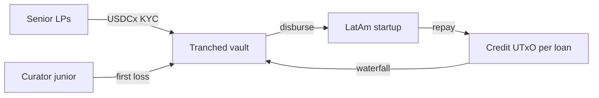

# nudu Growth Protocol

**Curated lending on Cardano for Latin American startups** — net new LatAm capital into revenue-based loans (RBF), through curator-managed tranched vaults with a first-loss junior tranche.

| | |
| --- | --- |
| **Category** | Curated lending (Cardano PRIME) |
| **Status** | Greenfield — contracts and tooling starting on preprod |
| **Denomination** | USDCx · no protocol token (12‑month horizon) |
| **Company** | [nudu](https://trynudu.com) · Buenos Aires |

---

## Why Cardano needs this

Lending on Cardano today is mostly **over-collateralized crypto credit**. Curated vaults — where a curator with skin in the game selects borrowers and sets terms — are a ~$11B pattern on other chains (Morpho alone ~46%) but **not yet on Cardano**. There is also no lending product whose yield is tied to **real-economy cash flows** rather than ADA volatility, so TVL tends to leave when the market turns.

We complement what already exists:

| Project | Role relative to us |
| --- | --- |
| **Liqwid** (~$10.5M TVL) | Crypto collateral only; planned home for **idle vault liquidity** (phase 2+) |
| **RealFi** (USDrf / sUSDrf) | Real-world credit; anchor senior line in phase 1; we bring **LatAm deal flow** nudu already works with off-chain |

Deposits go **straight into contracts** — the protocol never takes custody of user funds. Loans are 6–18 month stablecoin RBF: liquidity that is meant to **stay on-chain** through the cycle.

---

## How it works



1. **Senior** and **junior** depositors fund a vault; each tranche gets a native **share token**.
2. The **curator** approves startups and loan terms; disbursements require curator authorization and vault **concentration limits**.
3. Borrowers **repay a share of revenue**; a **waterfall** pays protocol and curator fees on interest, then senior rate (pro rata), then junior; **losses hit junior first**.
4. Off-chain, a **revenue attester** signs attestations (payment processor / accounting); each loan is backed by a legal credit agreement referencing the on-chain loan.

Full narrative, money flows, and 12‑month roadmap: **[docs/curated-lending-for-latam-startups.pdf](docs/curated-lending-for-latam-startups.pdf)**.

---

## Users

| Actor | Who | What they get |
| --- | --- | --- |
| **Senior depositors** | LatAm family offices, funds, stablecoin holders | USD yield from real businesses; Argentina first |
| **Borrowers** | SaaS, fintech, ecommerce with verifiable revenue | Non-dilutive RBF instead of equity |
| **Curators** | nudu first, then accelerators / local VCs | Own vault + junior tranche as first-loss buffer |

Later: open **Aiken** vault templates, an **SDK**, and a **public data API** (TVL, loan book, repayments) so wallets and apps can integrate.

---

## On-chain scope

Everything below is **Aiken** on Cardano.

| Component | Description |
| --- | --- |
| **Tranched vault** | USDCx in senior or junior; mint/burn share tokens; senior deposits **KYC-gated** |
| **Credit contract** | One UTxO per loan (principal, revenue %, cap, schedule); curator-gated; e.g. max **10%** of vault per startup (configurable) |
| **Waterfall** | Interest: fees → senior → junior; principal to vault; losses absorb junior first |
| **Idle liquidity** *(phase 2+)* | Liqwid / USDCx; cap **20–30%** in sUSDrf (RealFi Efficiency Layer) |

**Phase 1 MVP (in development):** vault, credit, waterfall, KYC whitelist token, single revenue attester — **preprod**. No idle-liquidity module, external curators, or governance token yet.

**Integrations (roadmap):** USDCx (Circle xReserve), RealFi, Liqwid, KYC provider, Blockfrost or Ogmios. No bridges; no price oracle — all stablecoin-denominated.

**Economics:** protocol fee on interest + curator performance fee, both in **USDCx**.

---

## Repository layout

```
aiken.toml            # Aiken project (trynudu/growth-protocol)
lib/                  # Pure types, constants, waterfall math
validators/           # Vault, credit, share and whitelist policies
docs/                 # Product PDF and future specs
.cursor/rules/        # Cursor rules for contracts, invariants, and future web app
```

### Build contracts

Requires [Aiken](https://aiken-lang.org/installation-instructions) **v1.1.19** (or `npm install` and use the scripts below):

```bash
aiken check -D    # typecheck + tests
aiken build       # compile validators
aiken fmt         # format .ak sources
```

With npm (local `@aiken-lang/aiken`):

```bash
npm install
npm run check
npm run build
```

### Agent / contributor rules

Persistent conventions for AI and humans:

| Rule | Applies to |
| --- | --- |
| [protocol-context](.cursor/rules/protocol-context.mdc) | Product scope, phase 1 boundaries |
| [engineering](.cursor/rules/engineering.mdc) | Integers, fail-closed, tests |
| [aiken-contracts](.cursor/rules/aiken-contracts.mdc) | `**/*.ak` layout and validator discipline |
| [lending-invariants](.cursor/rules/lending-invariants.mdc) | Waterfall, whitelist, credit rules |
| [web-domain](.cursor/rules/web-domain.mdc) | Future TS/JS frontend |

---

## Growth & TVL (illustrative, month 12)

| Source | USD | Qualifying TVL? |
| --- | ---: | --- |
| Senior — LatAm investors | $4.4M | Yes (net new) |
| Junior — curators | $0.7M | Yes |
| Senior — RealFi credit line | $1.9M | Likely no (PRIME founding-entity / double-count) |
| **Total in vaults** | **$7.0M** | **~$5.1M qualifying** |

Drivers: time-limited senior yield boost, monthly on-chain RBF repayments, RealFi anchor in phase 1, LatAm curators from phase 3. Idle liquidity in Liqwid/sUSDrf counted once under PRIME double-counting rules.

---

## PRIME application (reference)

<details>
<summary>RFP answers preserved from the original submission</summary>

1. **Category:** Curated lending.

2. **One line:** nudu Growth Protocol is a curated lending protocol on Cardano that channels net new Latin American capital into revenue-based loans to LatAm startups, through curator-managed vaults with a first-loss junior tranche.

3. **Why PRIME:** The hard part is first senior capital before track record. PRIME enables (1) pre–third-party-capital audit, (2) decaying senior incentive vs off-chain USD yield, (3) coordinated Liqwid + RealFi integration. Every dollar targets 6–18 month stablecoin loans.

4. **Cardano status:** Brand new, from scratch.

7. **First users & composability:** As in [Users](#users); composability via open Aiken vaults, SDK, public API.

9. **Technical scope:** As in [On-chain scope](#on-chain-scope); off-chain revenue oracle + legal agreements.

10. **TVL / activity:** As in [Growth & TVL](#growth--tvl-illustrative-month-12); monthly repayments and waterfall distributions.

11. **Token:** None planned; fees in USDCx; governance maybe after multiple independent curators.

</details>

---

## License

TBD.
