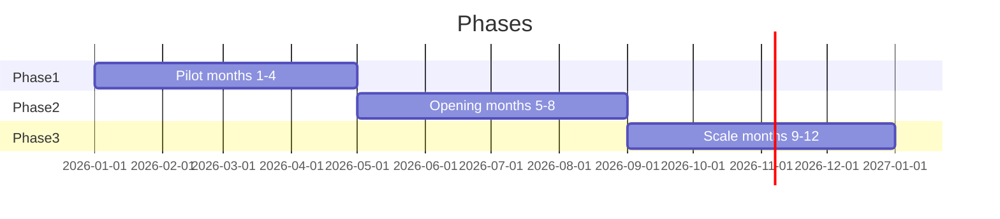

# 12-month roadmap

Illustrative plan from [curated-lending-for-latam-startups.pdf](./curated-lending-for-latam-startups.pdf) page 3. Senior mix percentages are **targets**, not projections.

## Phase 1 — Pilot (months 1–4)

**What we do**

- Vault and credit contracts in **Aiken** on **preprod**
- Security audit of contracts
- Agreement as RealFi’s LatAm direct-lending partner
- Own junior tranche as first-loss buffer
- First **3–5 RBF loans** to startups with verifiable revenue
- Revenue oracle to track sales

**Senior capital (illustrative):** RealFi **100%**

**Milestone:** Audited contracts, signed RealFi agreement, first loans repaying.

**On-chain MVP scope:** vault, credit, waterfall, KYC whitelist token, single attester — *not* idle liquidity or external curators.

---

## Phase 2 — Opening (months 5–8)

**What we do**

- **Mainnet** launch
- Senior tranche opens to **LatAm investors** (deposit straight into contract)
- Idle liquidity in Liqwid; up to **20–30%** in sUSDrf (Efficiency Layer)
- Public dashboard: TVL, loans, repayments
- Portfolio of **10–20** startups

**Senior capital (illustrative):** RealFi **70%** · LatAm **30%**

**Milestone:** First senior capital **not** from RealFi → qualifying TVL for PRIME.

---

## Phase 3 — Scale (months 9–12)

**What we do**

- More **external curators** (accelerators, local VCs), each with own vault
- Open **SDK** for wallets and apps
- Expansion to more LatAm countries
- RealFi becomes one investor among many

**Senior capital (illustrative):** RealFi **30%** · LatAm **70%**

**Milestone:** Majority of senior capital is **net new LatAm money** — durable, retained liquidity.

---

## Month-12 TVL illustration (from PDF)

| Source | USD | Qualifying TVL? |
| --- | ---: | --- |
| Senior — LatAm investors | $4.4M | Yes |
| Junior — curators | $0.7M | Yes |
| Senior — RealFi credit line | $1.9M | Likely no |
| **Total in vaults** | **$7.0M** | **~$5.1M qualifying** |
