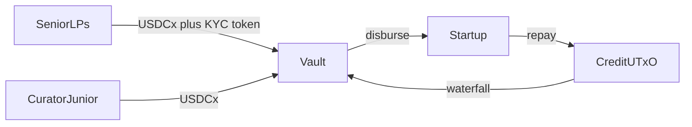

# Product spec (phase 1 focus)

Source narrative: [curated-lending-for-latam-startups.pdf](./curated-lending-for-latam-startups.pdf). This file is the searchable summary for engineering.

## One line

**nudu Growth Protocol** channels net new Latin American capital into revenue-based loans (RBF) to LatAm startups via curator-managed tranched vaults with a first-loss junior tranche — on Cardano, denominated in **USDCx**.

## Actors

| Actor | Role |
| --- | --- |
| **Senior depositors** | LatAm family offices, funds, stablecoin holders; paid first at lower rate |
| **Junior / curator capital** | First-loss buffer; curator selects deals and sets terms |
| **Borrowers** | LatAm startups (SaaS, fintech, ecommerce) with verifiable revenue |
| **Revenue attester** | Signs off-chain attestations of reported revenue (one key in MVP) |
| **RealFi** (phase 1) | Anchor senior credit line; LatAm direct-lending partner |
| **Protocol treasury** | Receives protocol fee on interest (USDCx) |

Investors deposit **directly into contracts** — no protocol custody wallet.

## On-chain components

### Tranched vault

- Accepts USDCx into **senior** or **junior** tranche.
- Mints native **share tokens** per tranche (one policy, two asset names).
- **Senior deposits:** only from addresses holding a **KYC whitelist** native token (minted under curator policy).
- Tracks per-tranche assets and share supply for pro-rata accounting.

### Credit contract

- **One UTxO per loan** with terms: principal, revenue-share %, repayment cap, schedule, borrower id, status.
- Disbursement requires **curator signature** and **concentration limit** (e.g. max 10% of vault TVL per startup — configurable in vault datum).
- Legal credit agreement off-chain references the on-chain loan.

### Waterfall (repayments)

On **interest** only (never fees on returned principal):

1. Protocol fee (bps of interest)
2. Curator performance fee (bps of interest)
3. Senior tranche at configured rate — **pro rata** among senior LPs
4. Junior tranche — residual interest
5. Principal returns to vault liquidity

**Losses:** junior NAV absorbs first; senior impaired only after junior buffer exhausted.

### Revenue oracle (off-chain + on-chain verify)

- Whitelisted **attester** signs revenue data (payment processor / accounting).
- Repay transactions verify attestation + borrower funds.

### Out of phase 1 (spec only)

- **Idle liquidity:** 70–80% Liqwid or USDCx; max 20–30% sUSDrf (RealFi Efficiency Layer).
- External curators (each own vault).
- Governance token (none planned for 12 months).

## Dependencies

| Integration | Use |
| --- | --- |
| USDCx (Circle xReserve) | Vault, loans, fees |
| RealFi USDrf / sUSDrf | Anchor + idle yield (later) |
| Liqwid | Idle liquidity (later) |
| KYC provider | Whitelist mint off-chain |
| Blockfrost / Ogmios | Chain access |

No bridges. No price oracle — all stablecoin-denominated.

## Money flows (summary)

## TVL note (PRIME)

Qualifying TVL is primarily **net new LatAm senior** + **curator junior**. RealFi credit line may be excluded under founding-entity / double-count rules. Idle liquidity in Liqwid/sUSDrf counted once under double-counting rules.

## Implementation status (repo)

| Piece | Status |
| --- | --- |
| Vault deposit / withdraw / config | Implemented (preprod wiring pending) |
| Share mint policy | Coupled to vault spend |
| Whitelist mint policy | Stub |
| Credit disburse / repay | Stub |
| Waterfall math (`lib/waterfall.ak`) | Implemented + tested |

See [roadmap.md](./roadmap.md) for milestones by month.
